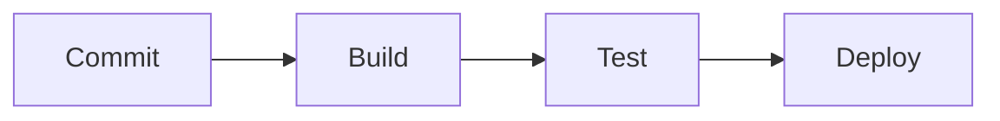

# Diagram CI/CD w Mermaid

## Diagram procesu

## Opis etapów

1. **Commit:** Deweloper wysyła nowe zmiany w kodzie do repozytorium (np. na GitHub/GitLab).
2. **Build:** System CI (np. GitHub Actions, Jenkins) automatycznie pobiera kod i kompiluje go lub tworzy obraz kontenera (np. Docker).
3. **Test:** Wdrożony automatyczny zestaw testów (jednostkowych, integracyjnych) weryfikuje poprawność kodu.
4. **Deploy:** Po pomyślnym przejściu testów aplikacja jest automatycznie wdrażana na środowisko docelowe (np. staging lub produkcję).